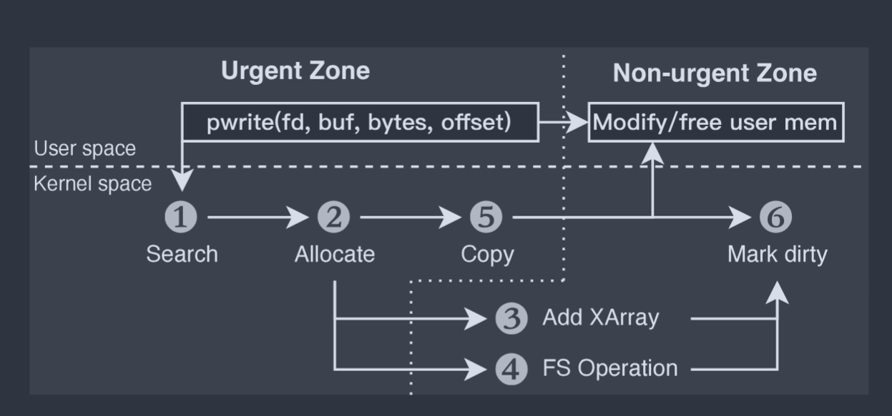
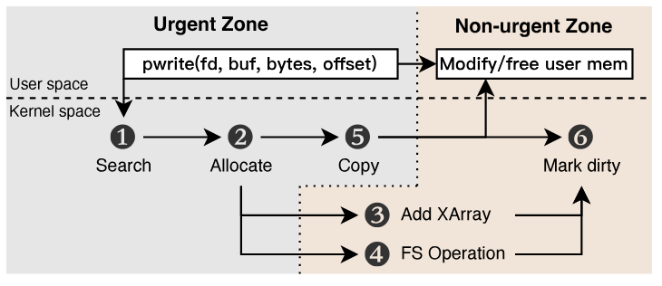

<p align="center">
  
</p>

<h1 align="center">Zotero Figure Guard</h1>

<p align="center">
  Keep figures in their original colors inside Zotero's dark-theme PDF reader while leaving the rest of the page dark.
</p>

<p align="center">
  <a href="https://www.zotero.org"></a>
  <a href="https://github.com/williamslay/Zotero-FigureGuard/releases"></a>
  <a href="https://github.com/williamslay/Zotero-FigureGuard/actions/workflows/ci.yml"></a>
  <a href="./LICENSE"></a>
  <a href="https://github.com/williamslay/Zotero-FigureGuard/stargazers"></a>
  <a href="https://github.com/williamslay/Zotero-FigureGuard/releases"></a>
</p>

<p align="center">
  <b>English</b> | <a href="./README.zh-CN.md">简体中文</a>
</p>

Zotero's built-in dark theme makes reading body text comfortable by inverting the entire PDF page—but it also applies the same blanket inversion and color remapping to every figure. In many papers, authors rely on distinct light fills or subtle hues on a white background (such as shaded regions, legend groups, or status blocks) to encode meaning; under Zotero's default dark mode, those different colors often collapse into the same muddy dark gray, losing critical information in the diagram.

**Zotero Figure Guard** automatically detects figure regions on each page and restores their original PDF colors in place, while keeping surrounding text and margins dark. It never modifies your PDF files, does not depend on Reading Mode, and leaves Zotero's layout and annotations untouched.

<table>
  <tr>
    <th width="50%">Zotero Dark Mode (Before)</th>
    <th width="50%">With Figure Guard (After)</th>
  </tr>
  <tr>
    <td align="center"></td>
    <td align="center"></td>
  </tr>
  <tr>
    <td>Blanket inversion collapses the distinct gray (<em>Urgent Zone</em>) and warm beige (<em>Non-urgent Zone</em>) fills into nearly identical dark gray.</td>
    <td>Original colors are preserved inside the figure, keeping the author's color-coded zones clear while the rest of the page stays dark.</td>
  </tr>
</table>

## Table of Contents

- [At a Glance](#at-a-glance)
- [Quick Start](#quick-start)
- [Compatibility & Scope](#compatibility--scope)
- [FAQ](#faq)
- [Development & Documentation](#development--documentation)
- [License](#license)

## At a Glance

- **Caption-anchored paper detection**: Built specifically for **academic research papers** with explicit figure captions (`Figure` / `Fig.` or PDF `/Figure` tags), detecting vector paths and embedded graphics (Form / Image XObjects) and merging grid or row-aligned subfigure panels into a unified region.
- **Selective color restoration**: Overlays original-color canvases on detected figure boxes while preserving Zotero's dark background for body text.
- **Responsive to reading flow**: Automatically re-renders across scrolling, zooming, page turns, window resizing, and tab switches, prioritizing the active foreground tab and visible pages.
- **Persistent per-attachment cache**: Caches detected figure regions and manual overrides under `<Zotero Data Directory>/figureguard/` so reopening a paper skips re-detection.
- **One-click toolbar toggle**: Adds a toggle button (`Original` / `原色` depending on Zotero's UI language) in the PDF reader toolbar so you can pause or re-enable protection anytime.
- **Built-in update support**: Configured with Zotero's add-on update manifest so future releases can be checked and updated directly inside Zotero.

## Quick Start

### 1. Install

1. Download the latest **`.xpi`** package from the [Releases page](https://github.com/williamslay/Zotero-FigureGuard/releases) (e.g. `zotero-figure-guard-<version>.xpi` — do not download the `Source code` archive).
2. In Zotero, open **Tools → Add-ons**.
3. Click the gear icon in the top-right corner → **Install Add-on From File…**, and select the downloaded `.xpi`.
4. Restart Zotero if prompted.

> `SHA256SUMS.txt` is published alongside each release if you want to verify the download checksum.

### 2. Usage

- Open any PDF in Zotero under the dark theme: figures on visible pages are automatically restored to their original colors.
- Click the **`Original`** (or **`原色`** in Chinese Zotero UI) toggle in the PDF reader toolbar whenever you want to temporarily switch back to the unfiltered dark view.

### 3. Updates

Once installed, future updates can be fetched directly inside Zotero via **Tools → Add-ons → gear icon → Check for Updates**.

## Compatibility & Scope

- **Zotero compatibility**: Built for **Zotero 7–10** (`figure-guard@zotero.org`); primary real-device testing is performed on **Zotero 10.0.8 / Windows**.
- **Primary target (academic papers, caption-driven)**: The detection algorithm is designed specifically for **scholarly research papers with explicit figure captions** (`Figure N` / `Fig. N` or PDF `/Figure` structure tags) in single-column and two-column layouts.
- **Intentional exclusions**: Pages without figure captions, uncaptioned standalone graphics (such as slides, posters, decorative illustrations, or uncaptioned screenshots), and **tables or algorithms** (`Table` / `Algorithm`) are intentionally skipped or rejected to prevent false positives on body prose and table layouts.

<details>
<summary>Known boundaries (click to expand)</summary>

- Uncaptioned figures, purely scanned bitmap PDFs, or unusual shading/masking pipelines are not covered (to maintain zero prose/table false positives in scholarly papers, uncaptioned graphics are intentionally skipped by the caption gate).
- Extreme edge-case layouts (such as pure-code figures or tightly mixed table/figure regions without clear caption separation) may occasionally be skipped or cropped imperfectly.
- The extension is in `0.x` active iteration; see [docs/KNOWN_ISSUES.md](./docs/KNOWN_ISSUES.md) for tracked items and verification status.

</details>

## FAQ

<details>
<summary><b>Does this plugin modify my PDF files?</b></summary>

No. Figure Guard renders lightweight overlay canvases in the reader view layer only and never alters PDF files on disk or Zotero annotations.

</details>

<details>
<summary><b>Where are cached regions stored, and what happens when I update or uninstall?</b></summary>

Cached detection boxes and manual overrides are stored per attachment as JSON files inside Zotero's data directory under `<Zotero Data Directory>/figureguard/cache/`. Your data is preserved when closing Zotero, disabling the add-on, or upgrading/downgrading versions. When you uninstall Zotero Figure Guard via Zotero Add-ons Manager, `<Zotero Data Directory>/figureguard/` is automatically removed (note: Zotero triggers bootstrap `uninstall` immediately when removal is initiated, before Undo in the Add-ons tab).

</details>

<details>
<summary><b>What if the toolbar toggle disappears after switching tabs, or figures turn gray after long scrolling?</b></summary>

Try toggling the **`Original`** / **`原色`** button off and on again or switching tabs. Automatic button re-mounting and off-screen canvas recovery are built in; if you can still reproduce the issue reliably, please open an issue with diagnostics attached.

</details>

<details>
<summary><b>How do I collect diagnostics for a bug report?</b></summary>

In Zotero, open **Tools → Developer → Run JavaScript** and run:

```js
Zotero.getMainWindow().FigureGuard.probeAll();
```

Include the returned JSON along with your Zotero version and OS when opening a report on [GitHub Issues](https://github.com/williamslay/Zotero-FigureGuard/issues).

</details>

## Development & Documentation

To build from source, run tests, or inspect internals:

```bash
npm ci
npm run test:ci
npm run build       # outputs dist/zotero-figure-guard-<version>.xpi
```

Developer guides, release procedures, and coding-agent contracts live in dedicated documents:

| Document | Audience | Contents |
| --- | --- | --- |
| [docs/DEVELOPMENT.md](./docs/DEVELOPMENT.md) | Contributors / Developers | Repository layout, three-layer architecture, XPI verification, two-tier tests, offline probes |
| [docs/KNOWN_ISSUES.md](./docs/KNOWN_ISSUES.md) | Contributors / Maintainers | Real-device issues, root-cause notes, and verification checklist |
| [docs/RELEASING.md](./docs/RELEASING.md) | Maintainers | Branch model, versioning rules, tag releases, and GitHub Pages `updates.json` |
| [AGENTS.md](./AGENTS.md) | AI Coding Agents | Module contracts, Zotero runtime facts, test baselines, engineering constraints |

## License

[MIT](./LICENSE) © williamslay
