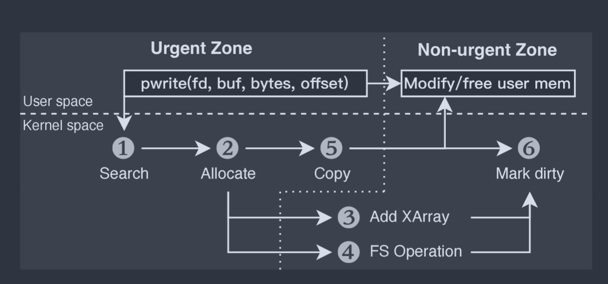
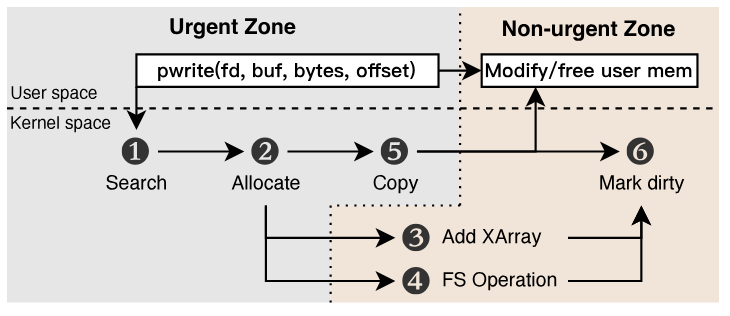

<p align="center">
  
</p>

<h1 align="center">Zotero Figure Guard</h1>

<p align="center">
  深色主题下，只让论文里的图表恢复原色，其余页面依然护眼。
</p>

<p align="center">
  <a href="https://www.zotero.org"></a>
  <a href="https://github.com/williamslay/Zotero-FigureGuard/releases"></a>
  <a href="https://github.com/williamslay/Zotero-FigureGuard/actions/workflows/ci.yml"></a>
  <a href="./LICENSE"></a>
  <a href="https://github.com/williamslay/Zotero-FigureGuard/stargazers"></a>
  <a href="https://github.com/williamslay/Zotero-FigureGuard/releases"></a>
</p>

<p align="center">
  <a href="./README.md">English</a> | <b>简体中文</b>
</p>

Zotero 原生深色主题会把整页 PDF 无差别反色与重映射：正文白字确实护眼，但论文里的所有插图也会跟着一起被反色。更麻烦的是，在白色版面中作者常会用不同浅色底纹或相近色调（例如分区底色、图例序列、高亮块）传递语义信息；而 Zotero 的默认暗黑反色往往会把原本不同的颜色一视同仁地压缩成同一种暗灰色，直接丢失图表原本想表达的区分度。

**Zotero Figure Guard** 会自动识别页面中的图表区域，只把这些区域恢复为 PDF 原始配色，其余正文与留白保持深色。它不会修改原始 PDF 文件，不依赖 Reading Mode，也不改变 Zotero 原有排版与批注交互。

<table>
  <tr>
    <th width="50%">Zotero 默认深色模式（使用前）</th>
    <th width="50%">使用 Figure Guard 恢复原色（使用后）</th>
  </tr>
  <tr>
    <td align="center"></td>
    <td align="center"></td>
  </tr>
  <tr>
    <td>整页反色后，左侧 <em>Urgent Zone</em> 与右侧 <em>Non-urgent Zone</em> 的不同底色几乎融成同一种深灰色，分区信息丢失。</td>
    <td>仅对图表区域恢复原色，浅灰与浅暖棕分区一目了然，页面其余正文仍保持深色阅读体验。</td>
  </tr>
</table>

## 目录

- [核心特性](#核心特性)
- [快速开始](#快速开始)
- [适用范围](#适用范围)
- [常见问题](#常见问题)
- [开发与文档](#开发与文档)
- [许可](#许可)

## 核心特性

- **面向科研论文的图注锚定识别**：主要针对具备规范图注（`Figure` / `Fig.` 或 PDF `/Figure` 结构标签）的**学术科研论文**设计，识别矢量路径与嵌入式图形（Form / Image XObject），并自动合并成行或网格排布的子图面板。
- **局部原色叠加**：仅在检测出的图表区域恢复 PDF 原始配色与白底，周围正文依然保持深色阅读体验。
- **平滑跟随阅读操作**：滚动、缩放、翻页、窗口尺寸调整与多标签切换后自动同步重绘，并优先处理当前正在阅读的前台标签页与可见页面。
- **按附件持久化缓存**：以条目与真实文档指纹为键将识别区域与手动修正持久化至 `<Zotero 数据目录>/figureguard/`，重新打开文献或重启 Zotero 均无需重复检测。
- **工具栏一键切换**：PDF 阅读器工具栏提供「**原色**」开关（非中文界面显示为 **Original**），可随时临时关闭或重新开启保护。
- **支持插件自动更新**：已接入 Zotero 插件更新机制，后续新版本发布后可在 Zotero 内直接检测更新。

## 快速开始

### 1. 安装插件

1. 前往 [Releases 页面](https://github.com/williamslay/Zotero-FigureGuard/releases) 下载最新版本的 **`.xpi`** 安装包（文件名形如 `zotero-figure-guard-<版本>.xpi`，请勿下载 `Source code` 压缩包）。
2. 打开 Zotero，进入 **工具 → 插件（Tools → Add-ons）**。
3. 点击右上角齿轮图标 → **Install Plugin From File…（从文件安装插件）**，选择刚下载的 `.xpi` 文件。
4. 如有提示，重启 Zotero 完成加载。

> Release 页面同时附带 `SHA256SUMS.txt`，可用于校验下载文件完整性。

### 2. 日常使用

- 在深色主题下打开任意 PDF 文献，插件会自动检测当前页中的图表并恢复原色。
- 需要查看纯深色整页效果时，点击阅读器工具栏上的 **原色** 按钮即可随时切换开关状态。

### 3. 更新插件

插件内置了更新清单地址。安装过一次之后，可在 Zotero 的 **工具 → 插件 → 齿轮 → 检查更新** 中直接接收后续版本升级，无需每次手动下载 `.xpi`。

## 适用范围

- **Zotero 兼容性**：面向 **Zotero 7–10**（`figure-guard@zotero.org`），当前真机主要验证环境为 **Zotero 10.0.8 / Windows**。
- **核心适用场景（科研论文 · 有图注为主）**：当前识别算法主要针对**带有规范图注的学术科研论文**（`Figure N` / `Fig. N` 英文图注或 PDF `/Figure` 结构标签，单栏/双栏排版）调校，以图注作为主锚点聚类还原图表区域。
- **主动过滤范围**：没有图注的页面、无图注独立图片（如幻灯片、海报、纯装饰配图或无名截图），以及**表格与算法块**（`Table` / `Algorithm`）会被主动跳过或拒绝，从而避免正文段落、规则线与表格底纹被误识别。

<details>
<summary>当前已知边界（点击展开）</summary>

- 无图注图片、纯位图扫描版 PDF 或特殊着色/遮罩绘制的插图暂不覆盖（为保证科研论文场景不误伤正文与表格，无图注图形会被图注兜底策略直接跳过）。
- 极端排版（如纯代码框构成的伪图形、图文混排且无清晰间距的区域）偶尔可能跳过或边界略有偏差。
- 插件当前处于 `0.x` 迭代阶段，检测规则与已知真机待完善项会持续跟进，详见 [已知问题](./docs/KNOWN_ISSUES.md)。

</details>

## 常见问题

<details>
<summary><b>插件会修改我的 PDF 文件吗？</b></summary>

不会。Figure Guard 只在阅读器视图层动态叠加原色画布，不会改动磁盘上的任何 PDF 文件或 Zotero 批注数据。

</details>

<details>
<summary><b>图框缓存与手动修改保存在哪里？更新或卸载插件时会如何处理？</b></summary>

自动识别结果与用户手动修改以每个附件独立的 JSON 文件形式保存在 `<Zotero 数据目录>/figureguard/cache/` 下。正常关闭 Zotero、禁用插件、升级或降级插件版本时，这些数据都会完整保留；在 Zotero 插件管理器中卸载 Figure Guard 时，插件会自动彻底清理 `<Zotero 数据目录>/figureguard/` 目录（注意：Zotero 10.0.8 在发起卸载阶段即触发 `uninstall()` 清理）。

</details>

<details>
<summary><b>遇到某篇 PDF 切换标签后开关消失，或滚动后图表变灰怎么办？</b></summary>

可先点击阅读器工具栏的「**原色**」开关关闭再重新开启，或切换一次标签页。当前版本已加入按钮自动补挂与画布离屏自愈机制，如果你仍能稳定复现异常，欢迎带上诊断信息提交 Issue。

</details>

<details>
<summary><b>如何获取诊断信息来反馈 Bug？</b></summary>

在 Zotero 中打开 **工具 → 开发者 → Run JavaScript**，粘贴并运行下面一行代码：

```js
Zotero.getMainWindow().FigureGuard.probeAll();
```

将返回的 JSON 结果连同 Zotero 版本、操作系统信息一起附到 [GitHub Issues](https://github.com/williamslay/Zotero-FigureGuard/issues) 中即可。

</details>

## 开发与文档

如果你想从源码自行打包、贡献代码，或查看内部实现细节：

```bash
npm ci
npm run test:ci
npm run build       # 生成 dist/zotero-figure-guard-<版本>.xpi
```

项目的维护文档、发布规范与 AI 编码代理规范已拆分到独立文档中，按需查阅：

| 文档 | 适用对象 | 内容说明 |
| --- | --- | --- |
| [docs/DEVELOPMENT.md](./docs/DEVELOPMENT.md) | 开发者 / 贡献者 | 目录结构、三层原理、XPI 校验、两级测试与离线诊断工具 |
| [docs/KNOWN_ISSUES.md](./docs/KNOWN_ISSUES.md) | 开发者 / 排查者 | 真机现象、已排查根因与待验证事项 |
| [docs/RELEASING.md](./docs/RELEASING.md) | 维护者 | 分支模型、版本号规则、Tag 发布与 GitHub Pages 自动更新清单 |
| [AGENTS.md](./AGENTS.md) | AI 编码代理 | 模块契约、Zotero 运行时事实、测试基线与工程约束 |

## 许可

[MIT](./LICENSE) © williamslay
